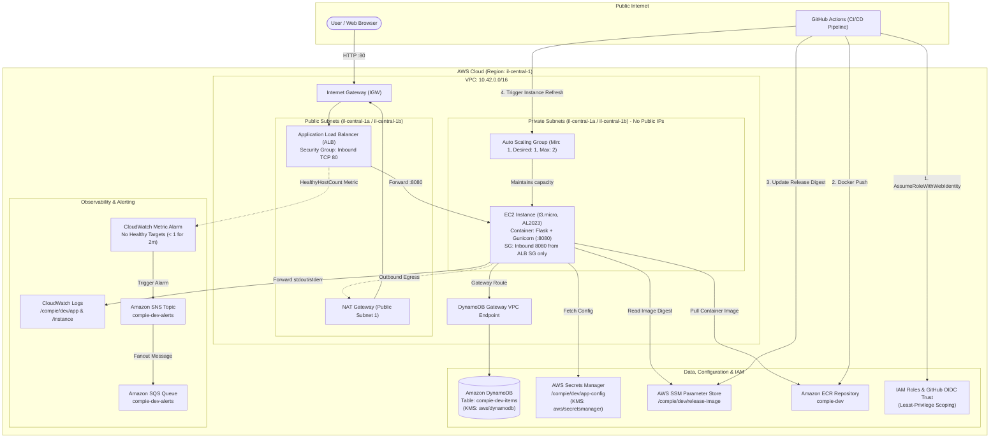

# Compie Items Board

One Flask application serves HTML/CSS, handles add/delete forms, and accesses DynamoDB. No browser JavaScript, Node.js, npm, Docker Compose, or standalone scripts directory is needed.

**Verified on October 25, 2026:** a push to `main` automatically built and tested the image, pushed it to ECR, refreshed the private EC2 instance, and served the pushed commit with database health `ok`. Both Terraform roots subsequently reported no changes.

Live application: [Items Board](http://compie-dev-alb-783445311.il-central-1.elb.amazonaws.com). The environment is temporary and may be removed after review.

Successful push-triggered runs: [Application](https://github.com/LiorTal26/Compie-HomeTask/actions/runs/40211715134) and [Infrastructure](https://github.com/LiorTal26/Compie-HomeTask/actions/runs/40211715491). The deployed release is `8d4597bfa0d4dee94a4208f35eb77a92cb073c48`; existing demo items survived the instance replacement. See the [evidence index](evidence/README.md) for results and verification limits.

## Project

- `app.py`: routes, database access, runtime configuration, and `/health`.
- `templates/index.html` and `static/style.css`: server-rendered interface.
- `requirements.txt` and `Dockerfile`: Python dependencies and container.
- `infra/bootstrap` and `infra/dev`: foundational resources and the environment.
- `.github/workflows`: separate application and infrastructure workflows.
- `tests`: behavior checks, run inside the application image.

Request path: **browser → public ALB → private EC2/ASG → DynamoDB gateway endpoint**. Region: `il-central-1`.



## Run locally

Run these PowerShell commands from the repository root with Docker Desktop using Linux containers. Port `8080` must be available. Python dependencies install inside the image; the local run needs no AWS account or credentials.

Build the image, start DynamoDB Local and the application, then create the local table:

```powershell
docker build -t compie-items:local .
docker network create compie-local
docker run -d --name compie-db --network compie-local amazon/dynamodb-local:2.6.1 -jar DynamoDBLocal.jar -inMemory -sharedDb
docker run -d --name compie-app --network compie-local -p 127.0.0.1:8080:8080 --read-only --tmpfs /tmp --cap-drop ALL --security-opt no-new-privileges -e CONFIG_SOURCE=local -e DYNAMODB_ENDPOINT=http://compie-db:8000 compie-items:local
docker exec compie-app flask --app app:create_app init-local-db
```

Check both required endpoints:

```powershell
(Invoke-WebRequest -Uri http://127.0.0.1:8080/).StatusCode
Invoke-RestMethod -Uri http://127.0.0.1:8080/health
docker inspect compie-app --format '{{.State.Health.Status}}'
```

Expected: `/` returns `200` and renders the board; `/health` returns `{"status":"ok","database":"ok","version":"local"}`. The version follows the image's `APP_VERSION` build argument. Docker reports `healthy` after its first successful health check; it may initially report `starting`.

Open **http://localhost:8080** in a browser. Add an item, reload to confirm it remains, then delete it. Forms reload the page without browser JavaScript. `/health` makes a real database query and returns `503` if that query fails. Input is limited to 200 characters; Jinja escapes user text. The board shows up to 100 recent records.

The second local container is a disposable **test database**. In AWS, DynamoDB is managed by AWS; only the Flask container runs on EC2. Restarting the app preserves local records. Removing the in-memory DB discards local records.

```powershell
docker run --rm --entrypoint python -v "${PWD}/tests:/app/tests:ro" compie-items:local -m unittest discover -s tests -v
docker restart compie-app
docker logs compie-app
```

Local cleanup; use this before repeating the startup commands if the container or network names already exist:

```powershell
docker stop compie-app compie-db
docker rm compie-app compie-db
docker network rm compie-local
```

On an enterprise network, an existing trusted CA bundle can be mounted during build:

```powershell
docker build --secret id=pip_ca,src=PATH_TO_TRUSTED_CA.pem -t compie-items:local .
```

The optional CA is used only during dependency installation. It is not copied into the image, and certificate verification remains enabled.

### Docker practices

| Choice | Purpose |
|---|---|
| Slim Python base pinned by SHA-256 digest | Keeps the selected base image fixed until deliberately updated. |
| Direct Python dependencies pinned in `requirements.txt` | Controls their versions. Transitive dependencies are resolved by pip during the build. |
| Copy requirements before application code; `pip --no-cache-dir` | Reuses the dependency layer for code-only changes and avoids retaining pip's download cache. |
| Allowlist in `.dockerignore`; explicit application copies | Keeps Git history, Terraform state, credentials, evidence, and unrelated files out of the application build context. |
| `USER appuser`, UID `10001` | Runs the application without root privileges. |
| Gunicorn with exec-form `CMD`, listening on `8080` | Runs the web server directly as the container process and allows it to receive shutdown signals. |
| Database-backed `HEALTHCHECK` | Checks application and database readiness. |
| Read-only root filesystem, writable `/tmp`, dropped capabilities, `no-new-privileges` | Applies the runtime restrictions shown in the local command and EC2 startup configuration. |

A single stage is sufficient for this application: there is no frontend compilation or separate build output to copy into a runtime image. Application request logs go to stderr, which Docker captures.

Recorded local proof: [HTTP checks](evidence/docker-local-http.json), [runtime inspection](evidence/docker-runtime.json), and [browser screenshot](evidence/local-flask.jpg). The evidence was captured from the existing local build tagged `compie-items:local`, with version `flask-local`.

## Bootstrap AWS and GitHub

Prerequisites: AWS CLI v2, Terraform **1.13.5**, Docker, Git, and permission to configure the GitHub repository's Actions variables. Repository visibility is your choice; the assignment specifies a ZIP submission. Check `aws sts get-caller-identity` before provisioning.

On this workstation, the default AWS profile now assumes the read-only `compie-operator` role for inspections. Provisioning and local Terraform commands below require a separately authorized provisioning identity; the read-only profile cannot apply or destroy infrastructure or access Terraform state. The existing Infrastructure workflow uses its own CI role for dev plans/applies.

1. Use your GitHub repository and its `main` branch. This project targets `LiorTal26/Compie-HomeTask`. The original assignment PDF is ignored.
2. Match the repository's default OIDC subject. New repositories use `repo:OWNER@OWNER_ID/REPO@REPOSITORY_ID:ref:refs/heads/main`; this repository's IDs are owner `91834069` and repository `1433129391`. These identifiers are available in [GitHub repository metadata](https://api.github.com/repos/LiorTal26/Compie-HomeTask). No custom token settings are required. See [GitHub's OIDC reference](https://docs.github.com/en/actions/reference/security/oidc).
3. Copy `infra/bootstrap/terraform.tfvars.example` to the ignored `terraform.tfvars` and fill in the exact subject. Set `existing_oidc_provider_arn` if the account already has GitHub's OIDC provider; it will be reused and preserved.
4. Review and apply bootstrap locally:

   ```powershell
   terraform -chdir=infra/bootstrap init
   terraform -chdir=infra/bootstrap plan "-out=bootstrap.tfplan"
   terraform -chdir=infra/bootstrap apply bootstrap.tfplan
   terraform -chdir=infra/bootstrap output
   ```

5. Populate runtime configuration outside Terraform state:

   ```powershell
   New-Item -ItemType Directory -Path .local -Force
   '{"welcomeMessage":"A small app. A complete delivery path.","tableName":"compie-dev-items"}' | Set-Content .local/app-config.json
   $secret = terraform -chdir=infra/bootstrap output -raw app_config_secret_arn
   aws secretsmanager put-secret-value --secret-id $secret --secret-string file://.local/app-config.json --region il-central-1
   ```

6. Set GitHub repository variables from bootstrap outputs:

   | Variable | Value |
   |---|---|
   | `AWS_REGION` | `il-central-1` |
   | `ECR_REPOSITORY` | `ecr_repository_url` |
   | `APPLICATION_ROLE_ARN` | `application_role_arn` |
   | `INFRASTRUCTURE_ROLE_ARN` | `infrastructure_role_arn` |
   | `TF_STATE_BUCKET` | `state_bucket` |
   | `APPLICATION_URL` | Set after the first dev apply. |

Bootstrap state stays local and is excluded from submission; retain it until teardown. Dev state uses encrypted, versioned S3 storage with native locking. Provider lockfiles include Windows and Linux checksums.

## First deployment

Run **Application → Run workflow → mode: bootstrap**. It builds/tests the container, pushes an immutable image, and seeds the non-secret release parameter. Bootstrap mode refuses to run if the dev ASG already exists.

Run **Infrastructure → Run workflow → operation: apply**. This provisions networking, database, logs, alerts, ALB, and private compute. Set `APPLICATION_URL` from its summary.

The first automatic run can fail before variables/bootstrap are ready. Complete setup and explicitly run bootstrap mode. Future app changes on `main` deploy normally.

To operate Terraform locally, initialize the same dev backend:

```powershell
$bucket = terraform -chdir=infra/bootstrap output -raw state_bucket
terraform -chdir=infra/dev init -backend-config="bucket=$bucket" -backend-config="key=dev/terraform.tfstate" -backend-config="region=il-central-1" -backend-config="encrypt=true" -backend-config="use_lockfile=true"
terraform -chdir=infra/dev plan "-out=dev.tfplan"
terraform -chdir=infra/dev apply dev.tfplan
terraform -chdir=infra/dev output
```

## Releases and rollback

| Workflow | Trigger | Result |
|---|---|---|
| Application | Push to `main` changing `app.py`, templates, static files, tests, requirements, Dockerfile, `.dockerignore`, or the Application workflow; alternatively Run workflow in `release` mode. | Build and test, push to ECR, update the image digest, refresh the ASG, then verify `/`, database health, and the running commit. |
| Infrastructure | Push to `main` changing `infra/**` or the Infrastructure workflow; alternatively Run workflow with `plan` or `apply`. | Format/validate and plan `infra/dev`. Apply runs only for manual `operation: apply`, using the plan generated in that same job. |

Use `main` when manually dispatching either workflow. README/evidence-only commits skip both automatic workflows. Unpushed local commits do not start Actions.

The Application summary links to the live site and records the verified release commit, ECR digest, and database health. Once AWS bootstrap and repository variables are configured, a matching push performs the release without AWS console steps.

The earlier Infrastructure failure was a missing `secretsmanager:GetResourcePolicy` permission needed by Terraform's secret data source. Bootstrap now grants that metadata read on the one app secret, while both secret-value APIs remain explicitly denied. Compare the [earlier failed run](https://github.com/LiorTal26/Compie-HomeTask/actions/runs/40202252740) with the [successful no-change plan](https://github.com/LiorTal26/Compie-HomeTask/actions/runs/40211715491). Detailed new AWS snapshots and logs are supplied only in the submission ZIP.

- Both workflows share a concurrency group. Avoid local applies during a workflow deployment.
- ECR tags include commit/run/attempt and are immutable. Instances pull an image digest.
- The pipeline owns `/compie/dev/release-image`; Terraform narrowly ignores changes to its value. EC2 startup reads it and launches the container through systemd.
- Refresh uses `SkipMatching=false`, minimum healthy `100%`, maximum healthy `200%`, launching a replacement before terminating the old instance.
- The summary records the previous image. Recover by dispatching Application in `rollback` mode with its existing `sha256:...` digest. Recovery is manual; deployment errors remain failures.

The EC2 startup shell template installs Docker/CloudWatch and starts the container. It is part of the launch template, rather than a separate operator-helper framework.

## Networking, compute, and capacity

Terraform creates one VPC with two public and two private subnets across two Availability Zones. Public subnet default routes use the Internet Gateway; private subnet default routes use one NAT gateway. The internet-facing ALB occupies the public subnets and forwards HTTP requests to the ASG's instance target group on port `8080`.

The ASG uses a Terraform launch template to run the Docker container on Amazon Linux 2023 `t3.micro` instances in the private subnets. Public IP assignment is disabled in both the subnets and launch template. Docker and systemd manage the container on EC2.

Capacity is **min 1 / desired 1 / max 2**. The ASG maintains the desired capacity and uses ELB health checks to replace unhealthy instances. The target group checks `/health` every 15 seconds, expects HTTP `200`, and the ASG allows 300 seconds for startup. During releases, Instance Refresh starts the replacement before terminating the previous instance.

Capacity currently stays at one instance; no load-based scaling policy is configured. To increase capacity, change the ASG values in Terraform, for example to **2 / 2 / 4**, then plan and apply. For automatic scaling, add a CPU target-tracking policy after measuring the workload and allow that policy to manage desired capacity.

One steady instance and one NAT gateway keep the exercise small but allow instance or AZ failures to interrupt service. Higher availability would use at least two steady instances across the AZs and a NAT gateway per AZ.

Live configuration evidence: [networking and compute checks](evidence/network-compute-checks.json).

## Security and operations

Instances have no public IP and require IMDSv2. The ALB security group accepts public TCP `80` and can send TCP `8080` only to the application security group. The application security group accepts TCP `8080` only from the ALB security group and permits outbound TCP `443` for service access. No SSH ingress is configured; use SSM for administration. One NAT gateway provides outbound AWS-service access.

### Data store

Terraform provisions the managed DynamoDB table `compie-dev-items`. DynamoDB is an AWS regional service outside the VPC. The application reaches it through a gateway endpoint attached to both private route tables; database traffic follows that endpoint route rather than the NAT gateway. See [AWS's DynamoDB endpoint documentation](https://docs.aws.amazon.com/vpc/latest/privatelink/vpc-endpoints-ddb.html).

The endpoint policy allows only the application role's `Query`, `PutItem`, and `DeleteItem` operations on this table. The table resource policy is configured to deny data operations outside the specified endpoint and to principals other than the application role. These restrictions apply to table data; authorized Terraform control-plane operations remain available.

AWS database authentication uses temporary credentials from the EC2 instance profile. The table name comes from Secrets Manager and the region comes from runtime configuration. There is no database password or hardcoded AWS connection string. The dummy credentials and localhost endpoint in the source are limited to DynamoDB Local mode.

`/health` executes a real DynamoDB `Query` with a limit of one and returns `200` when it succeeds, or `503` when it fails. The application's forms also add, list, and delete table records.

The table uses `PAY_PER_REQUEST` for this short, low-traffic demo, with no provisioned read/write capacity to manage. Request and storage charges can apply; this is not a guarantee of free-tier usage. AWS's read/write free-tier capacity allowance uses provisioned mode; see [DynamoDB pricing](https://aws.amazon.com/dynamodb/pricing/). Destroying `infra/dev` removes the table. Keep the environment only while collecting and reviewing evidence, then follow the teardown commands below.

**Privacy check:** the application queries the table successfully. A non-root operator query through the explicit public DynamoDB endpoint returned `AccessDeniedException` with an explicit deny in the table's resource policy. The same denial occurred while a temporary identity policy allowed only `COUNT` queries on this table; the temporary policy was removed afterward. No item values were returned by that test.

An earlier comparison query using root credentials succeeded outside the VPC. That result is retained in the evidence; the demonstrated resource-policy denial is for the non-root operator. Root credentials are no longer the default CLI identity. An initial temporary-role probe could not obtain a session and was cleaned up.

Evidence: [table, endpoint, and live health](evidence/database-checks.json), [non-root denial test](evidence/database-operator-probe.json), [root comparison](evidence/database-outside-endpoint.json), and [initial temporary-role cleanup](evidence/database-nonroot-probe.json). No database records were changed and no secret values were retrieved.

### Image, configuration, and IAM

The private ECR repository is `108782097005.dkr.ecr.il-central-1.amazonaws.com/compie-dev`. Tags are immutable, scanning is enabled on push, and releases select an image by digest through the non-secret SSM parameter `/compie/dev/release-image`.

AWS runtime configuration is JSON in Secrets Manager at `/compie/dev/app-config`, containing `welcomeMessage` and `tableName`. Terraform creates only the secret metadata; its value is populated separately. EC2 supplies the secret ARN and `CONFIG_SOURCE=aws` to the container. Flask calls Secrets Manager through boto3 at startup using the EC2 instance role, then uses the configured table for DynamoDB requests. Configuration updates take effect after restarting the application or refreshing its instances. Local demo defaults apply only when `CONFIG_SOURCE=local`.

| Identity | Responsibility and limits |
|---|---|
| `compie-dev-instance` instance profile | Pull the project ECR image, read the app configuration, access the items table, read the release parameter, and write project logs. `AmazonSSMManagedInstanceCore` supports SSM management. |
| `compie-dev-application-ci` | Push to the project ECR repository, update the release parameter, and trigger/observe the project ASG refresh. Explicitly denies both `GetSecretValue` and `BatchGetSecretValue`. |
| `compie-dev-infrastructure-ci` | Manage the dev Terraform state and selected infrastructure operations. Can pass only the existing instance role to EC2; can inspect app-secret metadata but explicitly denies secret-value retrieval. |
| `compie-operator` | Read-only local metadata/evidence checks, with explicit denial of secret values. No provisioning, deletion, or permanent database-data permissions. |

Both CI roles use GitHub OIDC temporary credentials. Their trust policies match this repository's exact subject on `main` and audience `sts.amazonaws.com`. The workflows use their respective role ARNs. None of these roles has `AdministratorAccess` attached. ECR authorization uses `Resource: "*"` following [AWS's ECR policy example](https://docs.aws.amazon.com/AmazonECR/latest/userguide/security_iam_id-based-policy-examples.html); repository push/pull operations are scoped to the project repository.

Repository write access remains security-sensitive because deployed code executes with the instance identity. Denying secret-read APIs to CI protects direct API access; a trusted deployment can still run application code with runtime permissions.

**Local operator access:** the default CLI profile and named profile `compie-operator` now assume a scoped read-only role with one-hour sessions. A source IAM user, `compie-operator-source`, can only assume that role. Its access key is stored in the local AWS credentials file outside this repository; no console login was created. This account-access identity is separate from the assignment's Terraform-managed runtime and CI roles.

The original root credentials remain in the explicitly named `compie-root-bootstrap` profile and have not been retired. Routine inspections now use the non-root role, consistent with [AWS root-user guidance](https://docs.aws.amazon.com/IAM/latest/UserGuide/root-user-best-practices.html). Use the existing Infrastructure workflow for dev changes; this local profile has no provisioning or deletion permissions.

```powershell
aws sts get-caller-identity
aws sts get-caller-identity --profile compie-operator
```

Both commands should report an ARN starting with `arn:aws:sts::108782097005:assumed-role/compie-operator/`. See [operator setup evidence](evidence/operator-setup.json). The profile credentials and AWS CLI credential cache are excluded from submission.

Verification: [image, configuration, and IAM evidence](evidence/image-config-iam-checks.json), plus [recent application log delivery](evidence/app-runtime-log-proof.json). Secret metadata and permission simulations are recorded without secret values.

| Requirement | Implementation |
|---|---|
| App logs | JSON requests → Docker `awslogs` → `/compie/dev/app`. |
| Instance logs | CloudWatch agent collects cloud-init, bootstrap, and startup logs. |
| Retention | Seven days. Configuration contents are not logged. |
| Database encryption | Explicit AWS-managed KMS `aws/dynamodb`. |
| Config encryption | Secrets Manager, using `aws/secretsmanager`; values stay out of state. |
| Monitoring | `HealthyHostCount < 1` for two consecutive one-minute periods. |
| Alert receiver | CloudWatch → SNS → subscribed SQS, with a topic-restricted queue policy. |

```powershell
aws logs tail /compie/dev/app --since 15m --region il-central-1
aws logs tail /compie/dev/instance --since 15m --region il-central-1
$queue = terraform -chdir=infra/dev output -raw alert_queue_url
aws cloudwatch set-alarm-state --alarm-name compie-dev-no-healthy-targets --state-value ALARM --state-reason "Assignment notification-path test" --region il-central-1
aws sqs receive-message --queue-url $queue --wait-time-seconds 10 --max-number-of-messages 10 --region il-central-1
```

If already ALARM, wait for healthy metrics to restore OK before testing that transition. A forced state tests notification wiring, not a genuine outage. Real metrics restore the state. A real receiver would be an operations email or incident-management integration. The dashboard is a deferred bonus.

## Submission and teardown

The saved evidence covers the live page and database health, a push-triggered release, EC2 replacement, preservation of existing database items, private addressing, CI secret-access denial, KMS settings, CloudWatch logs, SNS/SQS delivery, and final Terraform plans with no changes. Manual rollback remains unexercised. The exact verification scope is recorded in [the validation summary](evidence/validation-summary.md).

Commit source and sanitized evidence, then package tracked files with a portable copy of Git history:

```powershell
git add .
git commit -m "Document verified AWS release and submission evidence"
New-Item -ItemType Directory -Path output -Force
git archive --format=zip --output=output/compie-devops-submission.zip HEAD
git bundle create output/git-history.bundle main
git bundle verify output/git-history.bundle
Compress-Archive -LiteralPath output/git-history.bundle -DestinationPath output/compie-devops-submission.zip -Update
if (Test-Path -LiteralPath output/submission-evidence) {
    Compress-Archive -Path output/submission-evidence/* -DestinationPath output/compie-devops-submission.zip -Update
}
```

The ZIP contains committed public source/evidence, `git-history.bundle`, and any local submission-evidence overlay. New detailed AWS verification files are kept in the ignored `output/submission-evidence` folder and added only to the ZIP. After extracting, reviewers can restore the public repository history with `git clone -b main ./git-history.bundle review-copy`; retain the ZIP's evidence directory for the private snapshots. The bundle does not copy this machine's Git configuration.

Credentials, Terraform state and binary plans, tools, local configuration, and the assignment PDF are excluded. The evidence includes text output from Terraform plans, which contains no state file or secret value. Inspect the ZIP before submission.

ALB, NAT, IPv4, EC2/EBS, requests, logs, and Secrets Manager can incur charges. US$15 is a short-lived planning target, not a hard cap. Check regional pricing and destroy promptly after saving evidence.

Stop new deployments. These commands require a separately authorized provisioning identity and the initialized backend; the read-only inspection profile cannot run teardown:

```powershell
terraform -chdir=infra/dev plan -destroy "-out=destroy.tfplan"
terraform -chdir=infra/dev apply destroy.tfplan
terraform -chdir=infra/bootstrap plan -destroy "-out=destroy.tfplan"
terraform -chdir=infra/bootstrap apply destroy.tfplan
```

Destroy dev before bootstrap. The dedicated state bucket/ECR permit deleting project objects/images; the disposable config secret has no recovery window. A reused OIDC provider is preserved. Confirm project resources are gone before discarding bootstrap state. Keep the source repository for review.
