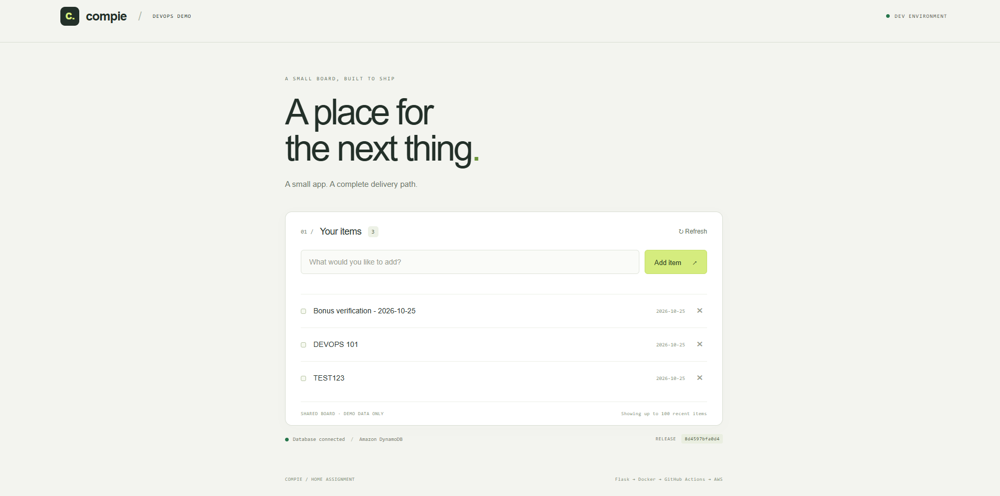
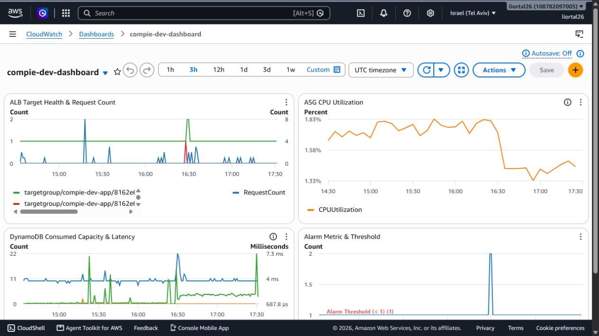

# Compie Items Board

A small Flask application with server-rendered HTML, DynamoDB storage, and GitHub Actions delivery to private EC2 instances behind a public ALB. Region: `il-central-1`.


The second EC2 represents optional scale-out capacity. [Editable diagram](docs/architecture.svg).

[Live application (HTTPS)](https://compie.tal-handassa.com) · [Database health](https://compie.tal-handassa.com/health) · [Application release](https://github.com/LiorTal26/Compie-HomeTask/actions/runs/40281599765) · [Infrastructure plan](https://github.com/LiorTal26/Compie-HomeTask/actions/runs/40281599723)

Reviewed on **October 26, 2026**; individual evidence files retain their capture timestamps. The HTTPS application release and no-change infrastructure plan were verified at `6880be6` on `main`. The temporary AWS environment may be removed after review.

## Requirements checklist

### Guidelines — Docker

- [x] Dockerfile with pinned slim base, non-root user, Gunicorn, and DB-backed health check.
- [x] Clean local run and verified `/` and `/health`: [local HTTP proof](evidence/docker-local-http.json), [container settings](evidence/docker-runtime.json).

### Guidelines — Infrastructure (Terraform)

**Networking and compute**

- [x] One VPC, two public and two private subnets across two AZs; public ALB and private EC2 ASG without public IPs.
- [x] Terraform launch template, target group, ELB health checks, and sensible `1 / 1 / 2` initial capacity; SSM access and ALB-only application ingress.
- [x] Capacity/scaling trade-offs documented below; no ECS, EKS, or Kubernetes.

**Image, config, and IAM**

- [x] Immutable ECR image; runtime configuration read from Secrets Manager using the instance role.
- [x] Separate runtime, application CI, and infrastructure CI roles. OIDC for CI; explicit denial of app-secret value reads. Certificate and DNS management are scoped to this app.

**Data store**

- [x] DynamoDB on-demand with AWS-managed KMS encryption, a gateway endpoint, and app-role/endpoint data-access restrictions. [Database evidence](evidence/database-checks.json).
- [x] Real database health query and item operations. No database password or static AWS credentials in the image.

**Logging, encryption, and monitoring**

- [x] App and instance logs in CloudWatch with seven-day retention; KMS encryption for DynamoDB, Secrets Manager, and EBS.
- [x] Healthy-target alarm → SNS → SQS placeholder, with topic/subscription/queue policies and received alarm/recovery evidence. The production receiver is described below.

### Guidelines — CI/CD

- [x] A push of application changes to `main` builds/tests, pushes ECR, and rolls the ASG without manual AWS console steps. [Successful release](https://github.com/LiorTal26/Compie-HomeTask/actions/runs/40211715134).
- [x] Triggers, bootstrap, rollback procedure, apply/destroy, and capacity are documented. Credentials and state are excluded from the ZIP.

## Repository map

| Start here | Purpose |
|---|---|
| [app.py](app.py), [templates/](templates), [static/](static), [tests/](tests) | Flask routes, HTML, CSS, and unit checks |
| [Dockerfile](Dockerfile) | Application image and runtime settings |
| [infra/bootstrap/](infra/bootstrap) | State bucket, ECR, configuration metadata, and IAM |
| [infra/dev/](infra/dev) | Network, database, compute, HTTPS, logs, and alerts |
| [.github/workflows/](.github/workflows) | Application delivery, infrastructure changes, and PR checks |
| [Validation evidence](#validation-evidence) | Recorded checks, screenshots, and verification limits |

## Run locally

Use PowerShell 7 from the repository root, with Docker Desktop running Linux containers. No AWS credentials are needed. The application exposes `/` and `GET /health`; health performs a real database query and returns `200` or `503`.

```powershell
docker build -t compie-items:local .
docker network create compie-local
docker run -d --name compie-db --network compie-local `
  amazon/dynamodb-local:2.6.1 -jar DynamoDBLocal.jar -inMemory -sharedDb
docker run -d --name compie-app --network compie-local `
  -p 127.0.0.1:8080:8080 --read-only --tmpfs /tmp `
  --cap-drop ALL --security-opt no-new-privileges `
  -e CONFIG_SOURCE=local -e DYNAMODB_ENDPOINT=http://compie-db:8000 `
  compie-items:local
docker exec compie-app flask --app app:create_app init-local-db
(Invoke-WebRequest http://127.0.0.1:8080/).StatusCode
Invoke-RestMethod http://127.0.0.1:8080/health
docker inspect compie-app --format '{{.State.Health.Status}}'
```

Expected: `/` returns `200`; `/health` reports `database: ok`, `status: ok`, and `version: local`. Docker changes from `starting` to `healthy` after the health check. Open http://localhost:8080, add an item, reload, and delete it. The local database is disposable and loses records when its container stops.

The [Dockerfile](Dockerfile) uses a digest-pinned Python slim base, pinned direct dependencies, a cached dependency layer, non-root UID `10001`, Gunicorn, and a database-backed health check. `.dockerignore` allowlists only application files. There is no frontend build or JavaScript runtime. The CA build-secret option is available for an existing enterprise CA bundle; it does not disable TLS verification.

Run the unit checks and clean up locally:

```powershell
docker run --rm --entrypoint python -v "${PWD}/tests:/app/tests:ro" compie-items:local -m unittest discover -s tests -v
docker stop compie-app compie-db
docker rm compie-app compie-db
docker network rm compie-local
```

## Deploy to AWS

Prerequisites: Terraform **1.13.5**, AWS CLI v2, Git, a GitHub repository using `main`, and an AWS provisioning identity. The workstation's `compie-operator` profile is read-only and cannot provision, access Terraform state, or destroy. Use your authorized provisioning profile for the commands below. Keep credentials outside the repository. Copy examples only for a new configuration; preserve existing `terraform.tfvars` files when updating the deployed stack.

### 1. Bootstrap the account

Copy the example and edit `github_subject` to match your repository's exact main-branch OIDC subject. This repository uses `repo:LiorTal26@91834069/Compie-HomeTask@1433129391:ref:refs/heads/main`. Set `existing_oidc_provider_arn` if the account already has GitHub's OIDC provider. For HTTPS, also set `https_domain_name` and `https_hosted_zone_id` in bootstrap inputs; these restrict CI certificate/DNS permissions to your app hostname and existing public zone.

```powershell
$env:AWS_PROFILE = "YOUR_PROVISIONING_PROFILE"
aws sts get-caller-identity
Copy-Item infra/bootstrap/terraform.tfvars.example infra/bootstrap/terraform.tfvars
# Edit infra/bootstrap/terraform.tfvars before continuing.
terraform -chdir=infra/bootstrap init
terraform -chdir=infra/bootstrap plan "-out=bootstrap.tfplan"
terraform -chdir=infra/bootstrap apply bootstrap.tfplan
terraform -chdir=infra/bootstrap output
```

Bootstrap creates ECR, the private versioned state bucket, GitHub OIDC roles, the EC2 instance profile, configuration-secret metadata, and the release parameter. Its state stays local: retain it until teardown and exclude it from submission.

### Infrastructure layout

Both Terraform roots are split into files by responsibility with explicit variable definitions (`variables.tf`, `outputs.tf`, `terraform.tfvars.example`):

| Root | Files | Purpose |
|---|---|---|
| `infra/bootstrap` | [`main.tf`](infra/bootstrap/main.tf), [`variables.tf`](infra/bootstrap/variables.tf), [`storage.tf`](infra/bootstrap/storage.tf), [`parameters.tf`](infra/bootstrap/parameters.tf), [`iam.tf`](infra/bootstrap/iam.tf), [`outputs.tf`](infra/bootstrap/outputs.tf) | OIDC provider, S3 backend bucket, ECR repository, IAM instance & CI roles, and secret metadata. |
| `infra/dev` | [`main.tf`](infra/dev/main.tf), [`variables.tf`](infra/dev/variables.tf), [`network.tf`](infra/dev/network.tf), [`compute.tf`](infra/dev/compute.tf), [`data.tf`](infra/dev/data.tf), [`observability.tf`](infra/dev/observability.tf), [`https.tf`](infra/dev/https.tf), [`outputs.tf`](infra/dev/outputs.tf) | VPC, ALB, ASG, DynamoDB + Endpoint, CloudWatch dashboard/alerts, and ACM/HTTPS. |

### 2. Set runtime configuration and GitHub variables

Populate the secret separately so configuration values stay out of Terraform state:

```powershell
New-Item -ItemType Directory -Path .local -Force
'{"welcomeMessage":"A small app. A complete delivery path.","tableName":"compie-dev-items"}' | Set-Content .local/app-config.json -Encoding utf8
$secret = terraform -chdir=infra/bootstrap output -raw app_config_secret_arn
aws secretsmanager put-secret-value --secret-id $secret --secret-string file://.local/app-config.json --region il-central-1
```

In **GitHub → Settings → Secrets and variables → Actions → Variables**, set:

| Repository variable | Value |
|---|---|
| `AWS_REGION` | `il-central-1` |
| `ECR_REPOSITORY` | Bootstrap output `ecr_repository_url` |
| `APPLICATION_ROLE_ARN` | Bootstrap output `application_role_arn` |
| `INFRASTRUCTURE_ROLE_ARN` | Bootstrap output `infrastructure_role_arn` |
| `TF_STATE_BUCKET` | Bootstrap output `state_bucket` |
| `APPLICATION_URL` | Set after the first dev apply below; currently `https://compie.tal-handassa.com`. |
| `APPLICATION_DOMAIN` | HTTPS hostname, e.g. `compie.tal-handassa.com`; leave empty for HTTP. |
| `ROUTE53_ZONE_ID` | Your existing public hosted-zone ID; set together with `APPLICATION_DOMAIN`. |

AWS access keys are not stored in GitHub. Both workflows use OIDC temporary credentials.

### 3. Publish the first image and apply dev

In **Actions → Application → Run workflow**, select branch `main` and mode **`bootstrap`**. Wait for success: this builds/tests the image, pushes it to ECR, and sets the initial release digest. Bootstrap mode is only for an environment whose ASG does not yet exist.

Initialize the dev backend and apply the environment:

```powershell
$bucket = terraform -chdir=infra/bootstrap output -raw state_bucket
terraform -chdir=infra/dev init `
  "-backend-config=bucket=$bucket" `
  "-backend-config=key=dev/terraform.tfstate" `
  "-backend-config=region=il-central-1" `
  "-backend-config=encrypt=true" `
  "-backend-config=use_lockfile=true"
Copy-Item infra/dev/terraform.tfvars.example infra/dev/terraform.tfvars
# For HTTPS, edit domain_name and hosted_zone_id to your own DNS inputs.
terraform -chdir=infra/dev plan "-out=dev.tfplan"
terraform -chdir=infra/dev apply dev.tfplan
$url = terraform -chdir=infra/dev output -raw application_url
Invoke-RestMethod "$url/health"
```

Set GitHub's **`APPLICATION_URL`** variable to `$url`. Open that URL and add an item. Dev state uses encrypted S3 storage, versioning, and native locking. Reuse this backend configuration when operating the existing stack; do not bootstrap another copy to inspect it.

## CI/CD and rollback

| Workflow | Trigger | Result |
|---|---|---|
| [Application](.github/workflows/application.yml) | Push to `main` changing app code, templates, static files, tests, `requirements.txt`, `Dockerfile`, `.dockerignore`, or its workflow. Manual mode: `release`. | Build → unit and real DynamoDB Local CRUD checks → ECR push → update SSM image digest → ASG Instance Refresh → verify `/`, DB health, and release commit. |
| [PR checks](.github/workflows/pr-checks.yml) | Open/update a PR targeting `main`, or manual dispatch. | Terraform format/validation for both roots and a container build/unit tests. Read-only GitHub access; no AWS credentials or deployment. |
| [Infrastructure](.github/workflows/infrastructure.yml) | Push to `main` changing `infra/**` or its workflow: **plan only**. Manual `operation: apply`: **plan and apply**. | Format, validate, initialize the same S3 backend, and generate a plan. Manual apply uses that run's saved plan and checks health. |

The application and infrastructure workflows share `compie-dev-write` concurrency; avoid a local apply during a deployment. README/evidence/diagram-only changes do not trigger either workflow. Set the HTTPS repository variables before using Infrastructure CI. If HTTPS already exists in state, the workflow rejects empty DNS inputs to prevent an accidental downgrade.

Images use immutable tags and are deployed by digest. The pipeline owns `/compie/dev/release-image`; Terraform ignores changes to its value. Instance Refresh launches healthy replacements before terminating old instances (`100%` minimum healthy, `200%` maximum, `SkipMatching=false`).

**Rollback:** open the failed Application run's summary, copy the previous image's `sha256:...` digest, then run **Application → mode: `rollback` → image_digest: that digest**, on `main`. This selects the existing image and refreshes the ASG. Manual rollback is implemented but has not been exercised.

## Capacity, security, and operations

**Capacity:** `compie-dev-asg` starts at **min 1 / desired 1 / max 2**, with ELB health checks, a 300-second startup grace period, and `/health` checks every 15 seconds. CPU target tracking aims for **70%**, with **60-second warmup**. Terraform ignores later desired-capacity changes so it does not undo scaling. EC2 basic CPU metrics arrive every five minutes. The deployed policy was verified; no CPU stress test or load-triggered scaling event was performed.

One steady instance and one NAT gateway keep the exercise small but permit instance/AZ failures to interrupt service. For higher availability, use a minimum of two instances across AZs and a NAT gateway per AZ; increase the maximum after measuring demand.

| Control | Implementation |
|---|---|
| Network | Two public and two private subnets across two AZs. Public routes use the Internet Gateway; private egress uses one NAT. EC2 has no public IP. |
| Access | Public ALB accepts HTTPS `443` with ACM and redirects HTTP `80` to the canonical HTTPS hostname; EC2 accepts `8080` only from the ALB security group. IMDSv2 is required; administration uses SSM, with no SSH ingress. |
| Database | DynamoDB on-demand. Gateway endpoint, endpoint policy, and table policy restrict app data access to the application role through that endpoint. A non-root outside-endpoint denial was verified; the earlier root comparison succeeded and is recorded in the evidence. |
| EBS | The launch template encrypts the root gp3 disk. The replacement instance's attached volume was verified encrypted with the AWS-managed EBS key. |
| Configuration / KMS | Flask reads runtime JSON from Secrets Manager at startup using its instance role. DynamoDB uses `aws/dynamodb`; Secrets Manager uses `aws/secretsmanager`. Both AWS-managed KMS keys were verified enabled. Configuration changes require an app restart or instance refresh. |
| IAM | Separate EC2 runtime, application CI, and infrastructure CI roles. CI explicitly denies secret-value reads. Infrastructure CI can pass only the project instance role. Routine local inspection uses a separate read-only operator. |
| Logs | App request IDs, status, duration, and release version → Docker `awslogs` → `/compie/dev/app`. CloudWatch agent sends cloud-init/bootstrap/service logs → `/compie/dev/instance`. Both retain seven days. |
| Alerting | `HealthyHostCount < 1` for two consecutive 60-second periods → SNS → subscribed SQS, with restricted topic/queue policies. An operations email or incident-management integration would replace the placeholder receiver. |
| Dashboard | Bonus `compie-dev-dashboard`: ALB health/traffic, ASG CPU, DynamoDB capacity/query latency, and the alarm threshold. |

Reach the logs directly:

```powershell
aws logs tail /compie/dev/app --since 15m --region il-central-1
aws logs tail /compie/dev/instance --since 15m --region il-central-1
```

## Validation evidence

Captured on October 25–26, 2026, in `il-central-1`. Individual files retain their capture times. [Validation summary and limits](evidence/validation-summary.md).

| Area | Evidence |
|---|---|
| Architecture | [PNG](docs/architecture.png), [editable SVG](docs/architecture.svg) |
| Local Docker | [HTTP checks](evidence/docker-local-http.json), [runtime inspection](evidence/docker-runtime.json), [local checks](evidence/local-validation.md) |
| Live application and database | [HTTPS items board](evidence/live-app-dynamodb-proof.png), [DynamoDB write proof](evidence/dynamodb-live-proof.json), [health response](evidence/live-health.json) |
| Commit → running application | [Push release](https://github.com/LiorTal26/Compie-HomeTask/actions/runs/40211715134), [final HTTPS release](https://github.com/LiorTal26/Compie-HomeTask/actions/runs/40281599765), [workflow metadata](evidence/workflow-run.json) |
| ASG capacity and replacement | [ASG overview](evidence/ASG%20PROOF.png), [replacement activity](evidence/ASG%20REPLACMENT%20PROOF%20FROM%20CD.png); existing items survived replacement |
| Terraform | [Bootstrap record](evidence/aws-bootstrap.md), [initial dev apply](evidence/terraform%20apply%20output%20proof.png), [final no-change plan](https://github.com/LiorTal26/Compie-HomeTask/actions/runs/40281599723), [earlier manual apply](https://github.com/LiorTal26/Compie-HomeTask/actions/runs/40217381960) |
| Network and compute | [VPC, routes, security groups, private instances, and healthy targets](evidence/network-compute-checks.json) |
| Image, configuration, and IAM | [ECR, secret metadata, instance profile, OIDC, and permission checks](evidence/image-config-iam-checks.json) |
| Encryption and runtime security | [KMS and CI access checks](evidence/security-checks.json); encrypted replacement EBS verified in the ZIP evidence |
| Private database access | [Table and endpoint policies](evidence/database-checks.json), [successful non-root denial](evidence/database-operator-probe.json) |
| Earlier database probes | [Root comparison](evidence/database-outside-endpoint.json), [temporary-role audit](evidence/database-nonroot-probe.json); root access succeeded, initial role test was inconclusive |
| Local operator | [Scoped read-only role setup](evidence/operator-setup.json) |
| Application logs | [Request records](evidence/app-logs.txt), [runtime log delivery](evidence/app-runtime-log-proof.json) |
| Instance logs | [CloudWatch startup records](evidence/instance-logs.txt) |
| Dashboard and metrics | [CloudWatch Dashboard screenshot](evidence/cloudwatch-dashboard.png), [Monitoring report](evidence/logging-encryption-monitoring.md) |
| Alarm → SNS → SQS | [Received ALARM](evidence/alert-alarm.json), [received recovery](evidence/alert-recovery.json) |
| PR checks | [PR #1](https://github.com/LiorTal26/Compie-HomeTask/pull/1), [successful validation run](https://github.com/LiorTal26/Compie-HomeTask/actions/runs/40227492186) |

Alarm messages show initial provisioning and recovery, not an injected outage. Manual rollback, teardown, and load-triggered scaling were not tested. Public snapshots include resource identifiers but no credentials or secret values; the latest detailed audit captures stay in the local ZIP.

<details>
<summary>Application and deployment screenshots</summary>

Public snapshots captured during the assignment; the ZIP contains the latest application, health, dashboard, and apply screenshots.







</details>

The architecture image is generated from the Terraform layout. Detailed results and limits are in the [validation summary](evidence/validation-summary.md).

## Destroy the AWS environment

Save evidence first, stop deployments, and use the provisioning profile and initialized backend from setup. **Destroy dev before bootstrap**; retain local bootstrap state until both steps finish.

```powershell
terraform -chdir=infra/dev plan -destroy "-out=destroy.tfplan"
terraform -chdir=infra/dev apply destroy.tfplan
terraform -chdir=infra/bootstrap plan -destroy "-out=destroy.tfplan"
terraform -chdir=infra/bootstrap apply destroy.tfplan
```

The assignment's ECR repository and state bucket allow deletion of their project images/objects; the disposable secret has no recovery window. A reused OIDC provider is preserved. Confirm resources are gone before discarding bootstrap state. The environment has not been destroyed as part of this documentation review. ALB, NAT, EC2/EBS, public IPv4, logs, and requests incur charges; the US$15 target is not a spending cap.

## Submission

The ZIP contains the application, Dockerfile, Terraform, workflows, README, screenshots, diagrams, and `git-history.bundle`. Credentials, local config, Terraform state/binary plans, tools, and the assignment PDF are excluded. Keep the private evidence overlay out of commits.

After committing selected source changes, package the repository and the local evidence overlay:

```powershell
New-Item -ItemType Directory -Path output -Force
git archive --format=zip --output=output/compie-devops-submission.zip HEAD
git bundle create output/git-history.bundle main
git bundle verify output/git-history.bundle
Compress-Archive -LiteralPath output/git-history.bundle -DestinationPath output/compie-devops-submission.zip -Update
if (Test-Path output/submission-evidence) {
    Compress-Archive -Path output/submission-evidence/* -DestinationPath output/compie-devops-submission.zip -Update
}
```

After extracting, `git clone -b main ./git-history.bundle review-copy` restores public source history. Keep the ZIP's evidence files alongside it for the private snapshots.

## Bonus deliverables

- [x] **CloudWatch dashboard:** four live-metric widgets; screenshot included in the ZIP.
- [x] **Architecture diagram/network sketch:** [PNG](docs/architecture.png), [editable SVG](docs/architecture.svg), and earlier HTML variants.
- [x] **AI-use artifacts:** [short implementation notes](docs/ai-notes.md) and the validation/evidence records.
- [ ] **Customer-managed KMS key:** deferred. AWS-managed keys cover database, configuration, and EBS encryption.
- [x] **Encrypted EBS in the launch template:** `encrypted = true`; encryption verified on the replacement root volume.
- [x] **HTTPS public endpoint:** [compie.tal-handassa.com](https://compie.tal-handassa.com), ACM DNS validation, TLS 1.2/1.3 listener, and HTTP 301 redirect.
- [x] **Dynamic ASG scaling:** CPU target tracking at 70%, with 60-second warmup. Configuration verified; no load-triggered scaling test performed.
- [x] **PR / pre-merge checks:** [PR #1](https://github.com/LiorTal26/Compie-HomeTask/pull/1) passed [Terraform and container checks](https://github.com/LiorTal26/Compie-HomeTask/actions/runs/40227492186). These are checks, not a claim that branch protection is enforced.
- [ ] **Second environment:** deferred; the submission contains one dev environment.

## Evaluation criteria — evidence map

| Assignment criterion | What was demonstrated |
|---|---|
| **1. Correctness** | Live HTTPS page, real database health, item persistence, successful Terraform provisioning, and a healthy replacement with encrypted EBS. |
| **2. Elegance / maintainability** | Two Terraform roots, files grouped by responsibility, pinned tools/providers, small Flask app, and documented configuration inputs. |
| **3. Security** | Private compute, ALB-only application ingress, SSM/IMDSv2, separate OIDC roles, scoped app DNS/certificate permissions, Secrets Manager, and KMS-backed encryption. |
| **4. Logging / monitoring** | Reachable request/startup logs, healthy-target alarm, SNS/SQS delivery evidence, and a dashboard screenshot. |
| **5. Pipeline** | Commit-to-running-app release and successful PR checks. Manual rollback is implemented but untested; zero downtime was not measured. |
| **6. Documentation** | Local run, bootstrap/apply, pipeline triggers, capacity, rollback, teardown commands, diagrams, screenshots, and linked proof. Teardown is documented; the current stack remains provisioned. |
