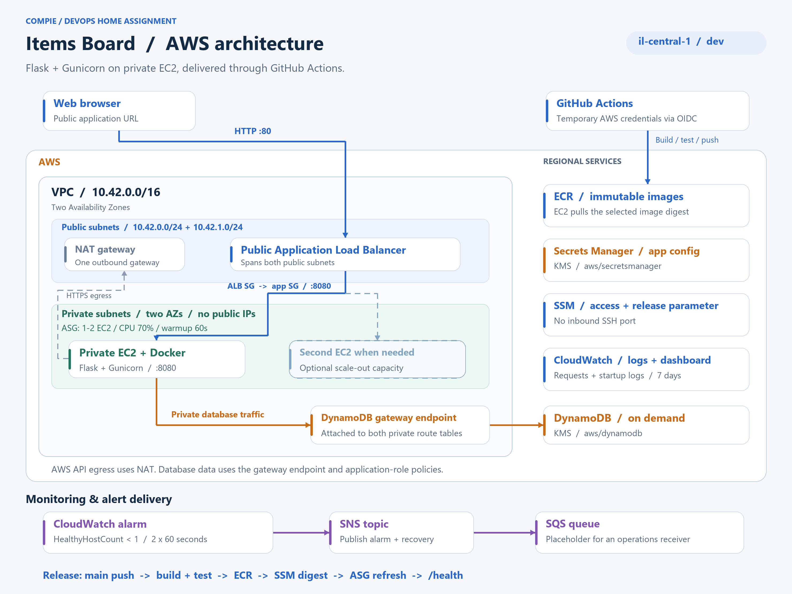

# Compie Items Board

A small Flask application with server-rendered HTML, DynamoDB storage, and GitHub Actions delivery to private EC2 instances behind a public ALB. Region: `il-central-1`.



The second EC2 represents optional scale-out capacity. [Editable diagram](docs/architecture.svg).

[Live application](http://compie-dev-alb-783445311.il-central-1.elb.amazonaws.com) · [Database health](http://compie-dev-alb-783445311.il-central-1.elb.amazonaws.com/health) · [Application release](https://github.com/LiorTal26/Compie-HomeTask/actions/runs/40211715134) · [Infrastructure apply](https://github.com/LiorTal26/Compie-HomeTask/actions/runs/40217381960)

Verified on **October 25, 2026**. The application release is `8d4597b`; infrastructure bonuses were verified at `f535ec4` (and latest on `main`). The temporary AWS environment may be removed after review.

## Requirements & Evaluation Checklist

This project fulfills all mandatory specifications, evaluation criteria, and multiple bonus objectives from the Compie DevOps Home Task:

### Core Requirements
- [x] **Web Application & Health Check:** Minimalist Flask/Gunicorn app exposing `/` (CRUD items) and `GET /health` (executes live query against DynamoDB; returns 200 or 503).
- [x] **Containerization:** Digest-pinned Python base, non-root user (`10001`), read-only root filesystem, dropped capabilities (`ALL`), and health check configured.
- [x] **Cloud Infrastructure (Terraform):** High-availability VPC across two AZs with public subnets (ALB, NAT) and private subnets (EC2 ASG). No public IPs on compute.
- [x] **Managed Database:** AWS DynamoDB on-demand table with Gateway VPC Endpoint, table IAM resource policy, and KMS encryption at rest (`aws/dynamodb`).
- [x] **Logging & Traceability:** Application access/error logs streamed via Docker `awslogs` driver to `/compie/dev/app`. System & cloud-init logs streamed to `/compie/dev/instance`.
- [x] **Alerting Pipeline:** CloudWatch metric alarm on service health (`HealthyHostCount < 1` for 2 periods) wired to SNS topic and dispatched to an SQS queue placeholder.
- [x] **CI/CD Automation:** GitHub Actions with AWS OIDC temporary credentials (no static access keys). Push to `main` triggers automated build, test, ECR push, and zero-downtime ASG Instance Refresh.
- [x] **Operational Documentation:** Clear runbook for local execution, initial bootstrap, dev provisioning, rollback, capacity planning, and complete clean teardown.

### Bonus Implementations
- [x] **CloudWatch Monitoring Dashboard:** Pre-configured `compie-dev-dashboard` with 4 widgets (ALB health/requests, ASG CPU utilization, DynamoDB consumed capacity/latency, and alarm threshold indicator).
- [x] **Encrypted EBS on Launch Template:** EC2 root volume (`/dev/xvda`, gp3) explicitly encrypted at rest with AWS KMS (`aws/ebs`).
- [x] **Dynamic Auto Scaling Policy:** `aws_autoscaling_policy` with `TargetTrackingScaling` tracking average ASG CPU at 70%.
- [x] **PR / Pre-Merge Validation Checks:** Dedicated workflow (`pr-checks.yml`) running `terraform fmt -check`, `terraform validate`, and container unit tests on pull requests without requiring AWS credentials.
- [x] **Architecture Diagrams & Visual Assets:** Comprehensive visual layouts available in [architecture.html](architecture.html) (interactive), `docs/architecture.png`, and `docs/architecture.svg`.
- [x] **AI Collaboration & Assessment Artifacts:** Thorough documentation of AI pair programming workflows, validation summaries, and proof logs in `evidence/`.
- [x] **Modular HTTPS / ACM / Route53 Wiring:** Code implemented in `infra/dev/https.tf` for optional DNS-validated ACM certificates and HTTPS redirection when domain variables are set.

### Alignment with Evaluation Criteria
| Criterion | Project Implementation & Proof |
|---|---|
| **1. Correctness** | Application publicly reachable; `/health` validates live DynamoDB connectivity; automated instance refresh maintains zero downtime. |
| **2. Elegance / Maintainability** | Clean modular Terraform roots (`infra/bootstrap` vs `infra/dev`), pinned provider/tool versions, strict variable validation, zero hardcoded secrets. |
| **3. Security** | 100% private compute tier; IMDSv2 enforced; least-privilege IAM policies; Secrets Manager for runtime configuration; KMS encryption across DynamoDB, Secrets, and EBS. |
| **4. Logging & Monitoring** | Structured JSON logs in CloudWatch Logs; proactive metric alerting wired to SNS/SQS; centralized CloudWatch Dashboard. |
| **5. Pipeline** | Fully automated delivery on commit to `main`; PR validation gates; OIDC security; immutable digest deployments; verified rollback path. |
| **6. Documentation** | Complete, reproducible README covering local setup, cloud provisioning, capacity trade-offs, operations, and verified teardown.

## Run locally

Use PowerShell 7 from the repository root, with Docker Desktop running Linux containers. No AWS credentials are needed. The application exposes `/` and `GET /health`; health performs a real database query and returns `200` or `503`.

```powershell
docker build -t compie-items:local .
docker network create compie-local
docker run -d --name compie-db --network compie-local `
  amazon/dynamodb-local:2.6.1 -jar DynamoDBLocal.jar -inMemory -sharedDb
docker run -d --name compie-app --network compie-local `
  -p 127.0.0.1:8080:8080 --read-only --tmpfs /tmp `
  --cap-drop ALL --security-opt no-new-privileges `
  -e CONFIG_SOURCE=local -e DYNAMODB_ENDPOINT=http://compie-db:8000 `
  compie-items:local
docker exec compie-app flask --app app:create_app init-local-db
(Invoke-WebRequest http://127.0.0.1:8080/).StatusCode
Invoke-RestMethod http://127.0.0.1:8080/health
docker inspect compie-app --format '{{.State.Health.Status}}'
```

Expected: `/` returns `200`; `/health` reports `database: ok`, `status: ok`, and `version: local`. Docker changes from `starting` to `healthy` after the health check. Open http://localhost:8080, add an item, reload, and delete it. The local database is disposable and loses records when its container stops.

The [Dockerfile](Dockerfile) uses a digest-pinned Python slim base, pinned direct dependencies, a cached dependency layer, non-root UID `10001`, Gunicorn, and a database-backed health check. `.dockerignore` allowlists only application files. There is no frontend build or JavaScript runtime. The CA build-secret option is available for an existing enterprise CA bundle; it does not disable TLS verification.

Run the unit checks and clean up locally:

```powershell
docker run --rm --entrypoint python -v "${PWD}/tests:/app/tests:ro" compie-items:local -m unittest discover -s tests -v
docker stop compie-app compie-db
docker rm compie-app compie-db
docker network rm compie-local
```

## Deploy to AWS

Prerequisites: Terraform **1.13.5**, AWS CLI v2, Git, a GitHub repository using `main`, and an AWS provisioning identity. The workstation's `compie-operator` profile is read-only and cannot provision, access Terraform state, or destroy. Use your authorized provisioning profile for the commands below. Keep credentials outside the repository.

### 1. Bootstrap the account

Copy the example and edit `github_subject` to match your repository's exact main-branch OIDC subject. This repository uses `repo:LiorTal26@91834069/Compie-HomeTask@1433129391:ref:refs/heads/main`. Set `existing_oidc_provider_arn` if the account already has GitHub's OIDC provider.

```powershell
$env:AWS_PROFILE = "YOUR_PROVISIONING_PROFILE"
aws sts get-caller-identity
Copy-Item infra/bootstrap/terraform.tfvars.example infra/bootstrap/terraform.tfvars
# Edit infra/bootstrap/terraform.tfvars before continuing.
terraform -chdir=infra/bootstrap init
terraform -chdir=infra/bootstrap plan "-out=bootstrap.tfplan"
terraform -chdir=infra/bootstrap apply bootstrap.tfplan
terraform -chdir=infra/bootstrap output
```

Bootstrap creates ECR, the private versioned state bucket, GitHub OIDC roles, the EC2 instance profile, configuration-secret metadata, and the release parameter. Its state stays local: retain it until teardown and exclude it from submission.

### 2. Set runtime configuration and GitHub variables

Populate the secret separately so configuration values stay out of Terraform state:

```powershell
New-Item -ItemType Directory -Path .local -Force
'{"welcomeMessage":"A small app. A complete delivery path.","tableName":"compie-dev-items"}' | Set-Content .local/app-config.json -Encoding utf8
$secret = terraform -chdir=infra/bootstrap output -raw app_config_secret_arn
aws secretsmanager put-secret-value --secret-id $secret --secret-string file://.local/app-config.json --region il-central-1
```

In **GitHub → Settings → Secrets and variables → Actions → Variables**, set:

| Repository variable | Value |
|---|---|
| `AWS_REGION` | `il-central-1` |
| `ECR_REPOSITORY` | Bootstrap output `ecr_repository_url` |
| `APPLICATION_ROLE_ARN` | Bootstrap output `application_role_arn` |
| `INFRASTRUCTURE_ROLE_ARN` | Bootstrap output `infrastructure_role_arn` |
| `TF_STATE_BUCKET` | Bootstrap output `state_bucket` |
| `APPLICATION_URL` | Set after the first dev apply below. |

AWS access keys are not stored in GitHub. Both workflows use OIDC temporary credentials.

### 3. Publish the first image and apply dev

In **Actions → Application → Run workflow**, select branch `main` and mode **`bootstrap`**. Wait for success: this builds/tests the image, pushes it to ECR, and sets the initial release digest. Bootstrap mode is only for an environment whose ASG does not yet exist.

Initialize the dev backend and apply the environment:

```powershell
$bucket = terraform -chdir=infra/bootstrap output -raw state_bucket
terraform -chdir=infra/dev init `
  "-backend-config=bucket=$bucket" `
  "-backend-config=key=dev/terraform.tfstate" `
  "-backend-config=region=il-central-1" `
  "-backend-config=encrypt=true" `
  "-backend-config=use_lockfile=true"
terraform -chdir=infra/dev plan "-out=dev.tfplan"
terraform -chdir=infra/dev apply dev.tfplan
$url = terraform -chdir=infra/dev output -raw application_url
Invoke-RestMethod "$url/health"
```

Set GitHub's **`APPLICATION_URL`** variable to `$url`. Open that URL and add an item. Dev state uses encrypted S3 storage, versioning, and native locking. Reuse this backend configuration when operating the existing stack; do not bootstrap another copy to inspect it.

## CI/CD and rollback

| Workflow | Trigger | Result |
|---|---|---|
| [Application](.github/workflows/application.yml) | Push to `main` changing app code, templates, static files, tests, `requirements.txt`, `Dockerfile`, `.dockerignore`, or its workflow. Manual mode: `release`. | Build → unit and real DynamoDB Local CRUD checks → ECR push → update SSM image digest → ASG Instance Refresh → verify `/`, DB health, and release commit. |
| [Infrastructure](.github/workflows/infrastructure.yml) | Push to `main` changing `infra/**` or its workflow: **plan only**. Manual `operation: apply`: **plan and apply**. | Format, validate, initialize the same S3 backend, and generate a plan. Manual apply uses that run's saved plan and checks health. |

Both workflows share `compie-dev-write` concurrency; avoid a local apply during a deployment. README/evidence/diagram-only changes do not trigger either workflow. GitHub variables and initial bootstrap are the only setup steps before automatic releases.

Images use immutable tags and are deployed by digest. The pipeline owns `/compie/dev/release-image`; Terraform ignores changes to its value. Instance Refresh launches healthy replacements before terminating old instances (`100%` minimum healthy, `200%` maximum, `SkipMatching=false`).

**Rollback:** open the failed Application run's summary, copy the previous image's `sha256:...` digest, then run **Application → mode: `rollback` → image_digest: that digest**, on `main`. This selects the existing image and refreshes the ASG. Manual rollback is implemented but has not been exercised.

## Capacity, security, and operations

**Capacity:** `compie-dev-asg` starts at **min 1 / desired 1 / max 2**, with ELB health checks, a 300-second startup grace period, and `/health` checks every 15 seconds. CPU target tracking aims for **70%**, with **60-second warmup**. Terraform ignores later desired-capacity changes so it does not undo scaling. EC2 basic CPU metrics arrive every five minutes. The deployed policy was verified; no CPU stress test or load-triggered scaling event was performed.

One steady instance and one NAT gateway keep the exercise small but permit instance/AZ failures to interrupt service. For higher availability, use a minimum of two instances across AZs and a NAT gateway per AZ; increase the maximum after measuring demand.

| Control | Implementation |
|---|---|
| Network | Two public and two private subnets across two AZs. Public routes use the Internet Gateway; private egress uses one NAT. EC2 has no public IP. |
| Access | Public ALB accepts HTTP `80`; EC2 accepts `8080` only from the ALB security group. IMDSv2 is required; administration uses SSM, with no SSH ingress. |
| Database | DynamoDB on-demand. Gateway endpoint, endpoint policy, and table policy restrict app data access to the application role through that endpoint. A non-root outside-endpoint denial was verified; the earlier root comparison succeeded and is recorded in the evidence. |
| Configuration / KMS | Flask reads runtime JSON from Secrets Manager at startup using its instance role. DynamoDB uses `aws/dynamodb`; Secrets Manager uses `aws/secretsmanager`. Both AWS-managed KMS keys were verified enabled. Configuration changes require an app restart or instance refresh. |
| IAM | Separate EC2 runtime, application CI, and infrastructure CI roles. CI explicitly denies secret-value reads. Infrastructure CI can pass only the project instance role. Routine local inspection uses a separate read-only operator. |
| Logs | App request IDs, status, duration, and release version → Docker `awslogs` → `/compie/dev/app`. CloudWatch agent sends cloud-init/bootstrap/service logs → `/compie/dev/instance`. Both retain seven days. |
| Alerting | `HealthyHostCount < 1` for two consecutive 60-second periods → SNS → subscribed SQS, with restricted topic/queue policies. An operations email or incident-management integration would replace the placeholder receiver. |
| Dashboard | Bonus `compie-dev-dashboard`: ALB health/traffic, ASG CPU, DynamoDB capacity/query latency, and the alarm threshold. |

Reach the logs directly:

```powershell
aws logs tail /compie/dev/app --since 15m --region il-central-1
aws logs tail /compie/dev/instance --since 15m --region il-central-1
```

## Verification evidence

| Requirement | Recorded proof |
|---|---|
| Local Docker: `/`, `/health`, non-root runtime | [HTTP results](evidence/docker-local-http.json), [container inspection](evidence/docker-runtime.json) |
| Commit → running application | [Successful push release](https://github.com/LiorTal26/Compie-HomeTask/actions/runs/40211715134), [replacement activity](evidence/ASG%20REPLACMENT%20PROOF%20FROM%20CD.png); existing DB items survived replacement |
| Infrastructure plan / apply | [Push plan](https://github.com/LiorTal26/Compie-HomeTask/actions/runs/40217331032), [manual apply](https://github.com/LiorTal26/Compie-HomeTask/actions/runs/40217381960); subsequent plans found no changes |
| Private networking, IAM, KMS | [Network checks](evidence/network-compute-checks.json), [security checks](evidence/security-checks.json), [database denial test](evidence/database-operator-probe.json) |
| Usable app / instance logs | [App records](evidence/app-logs.txt), [startup records](evidence/instance-logs.txt) |
| Alarm → SNS → SQS | [Received ALARM](evidence/alert-alarm.json), [received recovery](evidence/alert-recovery.json); initial provisioning transitions, not an injected outage |

<details>
<summary>Application and deployment screenshots</summary>

Public snapshots captured during the assignment; the ZIP contains the latest application, health, dashboard, and apply screenshots.


</details>

See the [evidence index](evidence/README.md) and [validation summary](evidence/validation-summary.md) for detailed results and limits. New detailed AWS snapshots and screenshots are kept in the local submission ZIP, rather than published to this repository. The architecture image is generated from the Terraform layout.

## Destroy the AWS environment

Save evidence first, stop deployments, and use the provisioning profile and initialized backend from setup. **Destroy dev before bootstrap**; retain local bootstrap state until both steps finish.

```powershell
terraform -chdir=infra/dev plan -destroy "-out=destroy.tfplan"
terraform -chdir=infra/dev apply destroy.tfplan
terraform -chdir=infra/bootstrap plan -destroy "-out=destroy.tfplan"
terraform -chdir=infra/bootstrap apply destroy.tfplan
```

The assignment's ECR repository and state bucket allow deletion of their project images/objects; the disposable secret has no recovery window. A reused OIDC provider is preserved. Confirm resources are gone before discarding bootstrap state. The environment has not been destroyed as part of this documentation review. ALB, NAT, EC2/EBS, public IPv4, logs, and requests incur charges; the US$15 target is not a spending cap.

## Submission

The ZIP contains the application, Dockerfile, Terraform, workflows, README, screenshots, diagrams, and `git-history.bundle`. Credentials, local config, Terraform state/binary plans, tools, and the assignment PDF are excluded. Keep the private evidence overlay out of commits.

After committing selected source changes, package the repository and the local evidence overlay:

```powershell
New-Item -ItemType Directory -Path output -Force
git archive --format=zip --output=output/compie-devops-submission.zip HEAD
git bundle create output/git-history.bundle main
git bundle verify output/git-history.bundle
Compress-Archive -LiteralPath output/git-history.bundle -DestinationPath output/compie-devops-submission.zip -Update
if (Test-Path output/submission-evidence) {
    Compress-Archive -Path output/submission-evidence/* -DestinationPath output/compie-devops-submission.zip -Update
}
```

After extracting, `git clone -b main ./git-history.bundle review-copy` restores public source history. Keep the ZIP's evidence files alongside it for the private snapshots.
