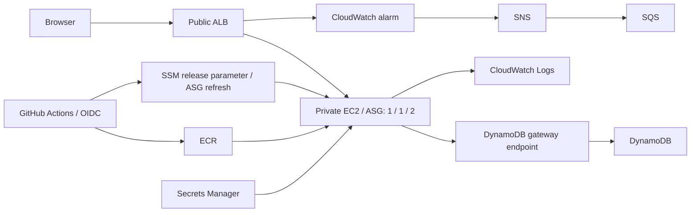

# Compie Items Board

One Flask application serves HTML/CSS, handles add/delete forms, and accesses DynamoDB. No browser JavaScript, Node.js, npm, Docker Compose, or standalone scripts directory is needed.

**Verified on October 25, 2026:** the application is deployed on AWS. A GitHub Actions release built and tested the image, pushed it to ECR, replaced the private EC2 instance, and passed the public database health check. Both Terraform roots subsequently reported no changes.

Live application: [Items Board](http://compie-dev-alb-783445311.il-central-1.elb.amazonaws.com). The environment is temporary and may be removed after review.

The successful [Application run](https://github.com/LiorTal26/Compie-HomeTask/actions/runs/40201715332) was manually dispatched. Push-based deployment is configured but was not separately demonstrated. See the [evidence index](evidence/README.md) for results and verification limits.

## Project

- `app.py`: routes, database access, runtime configuration, and `/health`.
- `templates/index.html` and `static/style.css`: server-rendered interface.
- `requirements.txt` and `Dockerfile`: Python dependencies and container.
- `infra/bootstrap` and `infra/dev`: foundational resources and the environment.
- `.github/workflows`: separate application and infrastructure workflows.
- `tests`: behavior checks, run inside the application image.

Request path: **browser → public ALB → private EC2/ASG → DynamoDB gateway endpoint**. Region: `il-central-1`.



## Run locally

Run these PowerShell commands from the repository root with Docker Desktop using Linux containers. Port `8080` must be available. Python dependencies install inside the image; the local run needs no AWS account or credentials.

Build the image, start DynamoDB Local and the application, then create the local table:

```powershell
docker build -t compie-items:local .
docker network create compie-local
docker run -d --name compie-db --network compie-local amazon/dynamodb-local:2.6.1 -jar DynamoDBLocal.jar -inMemory -sharedDb
docker run -d --name compie-app --network compie-local -p 127.0.0.1:8080:8080 --read-only --tmpfs /tmp --cap-drop ALL --security-opt no-new-privileges -e CONFIG_SOURCE=local -e DYNAMODB_ENDPOINT=http://compie-db:8000 compie-items:local
docker exec compie-app flask --app app:create_app init-local-db
```

Check both required endpoints:

```powershell
(Invoke-WebRequest -Uri http://127.0.0.1:8080/).StatusCode
Invoke-RestMethod -Uri http://127.0.0.1:8080/health
docker inspect compie-app --format '{{.State.Health.Status}}'
```

Expected: `/` returns `200` and renders the board; `/health` returns `{"status":"ok","database":"ok","version":"local"}`. The version follows the image's `APP_VERSION` build argument. Docker reports `healthy` after its first successful health check; it may initially report `starting`.

Open **http://localhost:8080** in a browser. Add an item, reload to confirm it remains, then delete it. Forms reload the page without browser JavaScript. `/health` makes a real database query and returns `503` if that query fails. Input is limited to 200 characters; Jinja escapes user text. The board shows up to 100 recent records.

The second local container is a disposable **test database**. In AWS, DynamoDB is managed by AWS; only the Flask container runs on EC2. Restarting the app preserves local records. Removing the in-memory DB discards local records.

```powershell
docker run --rm --entrypoint python -v "${PWD}/tests:/app/tests:ro" compie-items:local -m unittest discover -s tests -v
docker restart compie-app
docker logs compie-app
```

Local cleanup; use this before repeating the startup commands if the container or network names already exist:

```powershell
docker stop compie-app compie-db
docker rm compie-app compie-db
docker network rm compie-local
```

On an enterprise network, an existing trusted CA bundle can be mounted during build:

```powershell
docker build --secret id=pip_ca,src=PATH_TO_TRUSTED_CA.pem -t compie-items:local .
```

The optional CA is used only during dependency installation. It is not copied into the image, and certificate verification remains enabled.

### Docker practices

| Choice | Purpose |
|---|---|
| Slim Python base pinned by SHA-256 digest | Keeps the selected base image fixed until deliberately updated. |
| Direct Python dependencies pinned in `requirements.txt` | Controls their versions. Transitive dependencies are resolved by pip during the build. |
| Copy requirements before application code; `pip --no-cache-dir` | Reuses the dependency layer for code-only changes and avoids retaining pip's download cache. |
| Allowlist in `.dockerignore`; explicit application copies | Keeps Git history, Terraform state, credentials, evidence, and unrelated files out of the application build context. |
| `USER appuser`, UID `10001` | Runs the application without root privileges. |
| Gunicorn with exec-form `CMD`, listening on `8080` | Runs the web server directly as the container process and allows it to receive shutdown signals. |
| Database-backed `HEALTHCHECK` | Checks application and database readiness. |
| Read-only root filesystem, writable `/tmp`, dropped capabilities, `no-new-privileges` | Applies the runtime restrictions shown in the local command and EC2 startup configuration. |

A single stage is sufficient for this application: there is no frontend compilation or separate build output to copy into a runtime image. Application request logs go to stderr, which Docker captures.

Recorded local proof: [HTTP checks](evidence/docker-local-http.json), [runtime inspection](evidence/docker-runtime.json), and [browser screenshot](evidence/local-flask.jpg). The evidence was captured from the existing local build tagged `compie-items:local`, with version `flask-local`.

## Bootstrap AWS and GitHub

Prerequisites: AWS CLI v2, Terraform **1.13.5**, Docker, Git, and permission to configure the GitHub repository's Actions variables. Repository visibility is your choice; the assignment specifies a ZIP submission. Check `aws sts get-caller-identity` before provisioning.

1. Use your GitHub repository and its `main` branch. This project targets `LiorTal26/Compie-HomeTask`. The original assignment PDF is ignored.
2. Match the repository's default OIDC subject. New repositories use `repo:OWNER@OWNER_ID/REPO@REPOSITORY_ID:ref:refs/heads/main`; this repository's IDs are owner `91834069` and repository `1433129391`. These identifiers are available in [GitHub repository metadata](https://api.github.com/repos/LiorTal26/Compie-HomeTask). No custom token settings are required. See [GitHub's OIDC reference](https://docs.github.com/en/actions/reference/security/oidc).
3. Copy `infra/bootstrap/terraform.tfvars.example` to the ignored `terraform.tfvars` and fill in the exact subject. Set `existing_oidc_provider_arn` if the account already has GitHub's OIDC provider; it will be reused and preserved.
4. Review and apply bootstrap locally:

   ```powershell
   terraform -chdir=infra/bootstrap init
   terraform -chdir=infra/bootstrap plan "-out=bootstrap.tfplan"
   terraform -chdir=infra/bootstrap apply bootstrap.tfplan
   terraform -chdir=infra/bootstrap output
   ```

5. Populate runtime configuration outside Terraform state:

   ```powershell
   New-Item -ItemType Directory -Path .local -Force
   '{"welcomeMessage":"A small app. A complete delivery path.","tableName":"compie-dev-items"}' | Set-Content .local/app-config.json
   $secret = terraform -chdir=infra/bootstrap output -raw app_config_secret_arn
   aws secretsmanager put-secret-value --secret-id $secret --secret-string file://.local/app-config.json --region il-central-1
   ```

6. Set GitHub repository variables from bootstrap outputs:

   | Variable | Value |
   |---|---|
   | `AWS_REGION` | `il-central-1` |
   | `ECR_REPOSITORY` | `ecr_repository_url` |
   | `APPLICATION_ROLE_ARN` | `application_role_arn` |
   | `INFRASTRUCTURE_ROLE_ARN` | `infrastructure_role_arn` |
   | `TF_STATE_BUCKET` | `state_bucket` |
   | `APPLICATION_URL` | Set after the first dev apply. |

Bootstrap state stays local and is excluded from submission; retain it until teardown. Dev state uses encrypted, versioned S3 storage with native locking. Provider lockfiles include Windows and Linux checksums.

## First deployment

Run **Application → Run workflow → mode: bootstrap**. It builds/tests the container, pushes an immutable image, and seeds the non-secret release parameter. Bootstrap mode refuses to run if the dev ASG already exists.

Run **Infrastructure → Run workflow → operation: apply**. This provisions networking, database, logs, alerts, ALB, and private compute. Set `APPLICATION_URL` from its summary.

The first automatic run can fail before variables/bootstrap are ready. Complete setup and explicitly run bootstrap mode. Future app changes on `main` deploy normally.

To operate Terraform locally, initialize the same dev backend:

```powershell
$bucket = terraform -chdir=infra/bootstrap output -raw state_bucket
terraform -chdir=infra/dev init -backend-config="bucket=$bucket" -backend-config="key=dev/terraform.tfstate" -backend-config="region=il-central-1" -backend-config="encrypt=true" -backend-config="use_lockfile=true"
terraform -chdir=infra/dev plan "-out=dev.tfplan"
terraform -chdir=infra/dev apply dev.tfplan
terraform -chdir=infra/dev output
```

## Releases and rollback

- App changes on `main` build, run behavior checks and real DynamoDB Local operations, push to ECR, and refresh the ASG.
- Infrastructure changes produce a plan. Manual dispatch applies the saved plan from that run.
- Both workflows share a concurrency group. Avoid local applies during a workflow deployment.
- ECR tags include commit/run/attempt and are immutable. Instances pull an image digest.
- The pipeline owns `/compie/dev/release-image`; Terraform narrowly ignores changes to its value. EC2 startup reads it and launches the container through systemd.
- Refresh uses `SkipMatching=false`, minimum healthy `100%`, maximum healthy `200%`, launching a replacement before terminating the old instance.
- The summary records the previous image. Recover by dispatching Application in `rollback` mode with its existing `sha256:...` digest. Recovery is manual; deployment errors remain failures.

The EC2 startup shell template installs Docker/CloudWatch and starts the container. It is part of the launch template, rather than a separate operator-helper framework.

## Networking, compute, and capacity

Terraform creates one VPC with two public and two private subnets across two Availability Zones. Public subnet default routes use the Internet Gateway; private subnet default routes use one NAT gateway. The internet-facing ALB occupies the public subnets and forwards HTTP requests to the ASG's instance target group on port `8080`.

The ASG uses a Terraform launch template to run the Docker container on Amazon Linux 2023 `t3.micro` instances in the private subnets. Public IP assignment is disabled in both the subnets and launch template. Docker and systemd manage the container on EC2.

Capacity is **min 1 / desired 1 / max 2**. The ASG maintains the desired capacity and uses ELB health checks to replace unhealthy instances. The target group checks `/health` every 15 seconds, expects HTTP `200`, and the ASG allows 300 seconds for startup. During releases, Instance Refresh starts the replacement before terminating the previous instance.

Capacity currently stays at one instance; no load-based scaling policy is configured. To increase capacity, change the ASG values in Terraform, for example to **2 / 2 / 4**, then plan and apply. For automatic scaling, add a CPU target-tracking policy after measuring the workload and allow that policy to manage desired capacity.

One steady instance and one NAT gateway keep the exercise small but allow instance or AZ failures to interrupt service. Higher availability would use at least two steady instances across the AZs and a NAT gateway per AZ.

Live configuration evidence: [networking and compute checks](evidence/network-compute-checks.json).

## Security and operations

Instances have no public IP and require IMDSv2. The ALB security group accepts public TCP `80` and can send TCP `8080` only to the application security group. The application security group accepts TCP `8080` only from the ALB security group and permits outbound TCP `443` for service access. No SSH ingress is configured; use SSM for administration. One NAT gateway provides outbound AWS-service access.

DynamoDB is outside the VPC. The gateway endpoint and table policy restrict data access to the application role through that endpoint. Terraform control-plane operations remain available.

EC2, application CI, and infrastructure CI use separate roles. Both CI roles explicitly deny secret-value retrieval and lack database data permissions. Infrastructure CI has selected regional provisioning actions and can pass only the existing instance role. Repository write access remains security-sensitive because deployments execute with the instance identity.

| Requirement | Implementation |
|---|---|
| App logs | JSON requests → Docker `awslogs` → `/compie/dev/app`. |
| Instance logs | CloudWatch agent collects cloud-init, bootstrap, and startup logs. |
| Retention | Seven days. Configuration contents are not logged. |
| Database encryption | Explicit AWS-managed KMS `aws/dynamodb`. |
| Config encryption | Secrets Manager, using `aws/secretsmanager`; values stay out of state. |
| Monitoring | `HealthyHostCount < 1` for two consecutive one-minute periods. |
| Alert receiver | CloudWatch → SNS → subscribed SQS, with a topic-restricted queue policy. |

```powershell
aws logs tail /compie/dev/app --since 15m --region il-central-1
aws logs tail /compie/dev/instance --since 15m --region il-central-1
$queue = terraform -chdir=infra/dev output -raw alert_queue_url
aws cloudwatch set-alarm-state --alarm-name compie-dev-no-healthy-targets --state-value ALARM --state-reason "Assignment notification-path test" --region il-central-1
aws sqs receive-message --queue-url $queue --wait-time-seconds 10 --max-number-of-messages 10 --region il-central-1
```

If already ALARM, wait for healthy metrics to restore OK before testing that transition. A forced state tests notification wiring, not a genuine outage. Real metrics restore the state. A real receiver would be an operations email or incident-management integration. The dashboard is a deferred bonus.

## Submission and teardown

The saved evidence covers the live page and database health, a manually dispatched release, EC2 replacement, private addressing, CI secret-access denial, KMS settings, CloudWatch logs, SNS/SQS delivery, and final Terraform plans with no changes. Rollback and preservation of a specific AWS record across replacement were not separately exercised. The exact verification scope is recorded in [the validation summary](evidence/validation-summary.md).

Commit source and sanitized evidence, then package tracked files with a portable copy of Git history:

```powershell
git add .
git commit -m "Document verified AWS release and submission evidence"
New-Item -ItemType Directory -Path output -Force
git archive --format=zip --output=output/compie-devops-submission.zip HEAD
git bundle create output/git-history.bundle main
git bundle verify output/git-history.bundle
Compress-Archive -LiteralPath output/git-history.bundle -DestinationPath output/compie-devops-submission.zip -Update
```

The ZIP contains the committed source, evidence, and `git-history.bundle`. After extracting, reviewers can restore the repository with `git clone -b main ./git-history.bundle review-copy`. The bundle preserves commit history without copying this machine's Git configuration.

Credentials, Terraform state and binary plans, tools, local configuration, and the assignment PDF are excluded. The evidence includes text output from Terraform plans, which contains no state file or secret value. Inspect the ZIP before submission.

ALB, NAT, IPv4, EC2/EBS, requests, logs, and Secrets Manager can incur charges. US$15 is a short-lived planning target, not a hard cap. Check regional pricing and destroy promptly after saving evidence.

Stop new deployments. Using the local operator identity and initialized backend:

```powershell
terraform -chdir=infra/dev plan -destroy "-out=destroy.tfplan"
terraform -chdir=infra/dev apply destroy.tfplan
terraform -chdir=infra/bootstrap plan -destroy "-out=destroy.tfplan"
terraform -chdir=infra/bootstrap apply destroy.tfplan
```

Destroy dev before bootstrap. The dedicated state bucket/ECR permit deleting project objects/images; the disposable config secret has no recovery window. A reused OIDC provider is preserved. Confirm project resources are gone before discarding bootstrap state. Keep the source repository for review.
