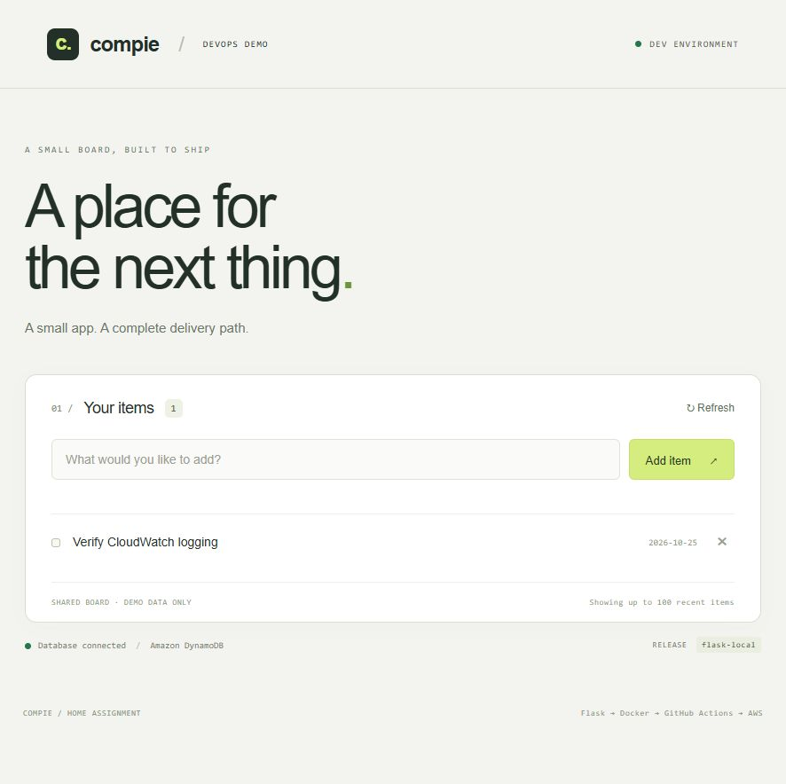

# Local validation — October 25, 2026

These results apply to the local Docker environment before AWS provisioning. Later AWS results are recorded in [validation-summary.md](validation-summary.md).

| Check | Result |
|---|---|
| Flask image build | Passed with Python 3.13, Flask 3.1.3, boto3 1.43.118, and Gunicorn 26.2.0. |
| Container user | `appuser`, not root. |
| Python dependency consistency | `pip check`: no broken requirements. |
| Behavior checks | Three unittest cases passed: forms/HTML escaping/deletion; invalid and oversized input; DB failure and health status. |
| Real database connection | `/health` returned `200` with `database: ok` against DynamoDB Local. |
| HTTP form submission | Added a record through the running Gunicorn server and read it on the rendered page. |
| Persistence | Restarted only the Flask container; the record remained in the database. |
| Browser add/delete | Submitted an HTML form, saw the new item, and deleted the earlier persistence-test item through its form. |
| Browser JavaScript | No JavaScript files or script elements. |
| Terraform | Both roots passed `terraform validate`; recursive formatting check passed. |
| GitHub Actions definitions | Both passed actionlint 1.7.7. This local check did not execute workflows; the later successful Application run is recorded separately. |

Local preview: http://localhost:8080

## Docker requirement recheck

Rechecked the running local container on October 25, 2026, at approximately 15:06 UTC:

- Host requests to `/` and `/health` both returned HTTP `200`; the home response contained HTML and health reported `database: ok`.
- The local image tag is `compie-items:local`, with application version `flask-local`.
- Docker reports `healthy`; the container runs Gunicorn as `appuser`, UID `10001`.
- Runtime inspection confirms a read-only root filesystem, writable `/tmp`, all Linux capabilities dropped, `no-new-privileges`, and host binding restricted to `127.0.0.1:8080`.
- `python -m pip check` inside the running container reported no broken requirements.

Raw results: [docker-local-http.json](docker-local-http.json) and [docker-runtime.json](docker-runtime.json). This recheck used the existing running image; it did not rebuild or replace it.

## Subsequent AWS verification

The live application, private EC2 placement, ECR release, OIDC authentication, instance refresh, CloudWatch logs, KMS settings, and SNS/SQS receipt have subsequent evidence in this directory. Manual rollback, an explicit database access-denial test outside the endpoint, and teardown have not been exercised as part of this final evidence pass.
